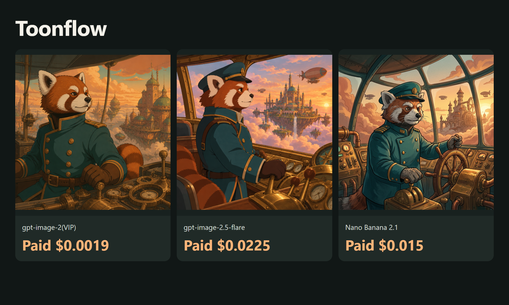
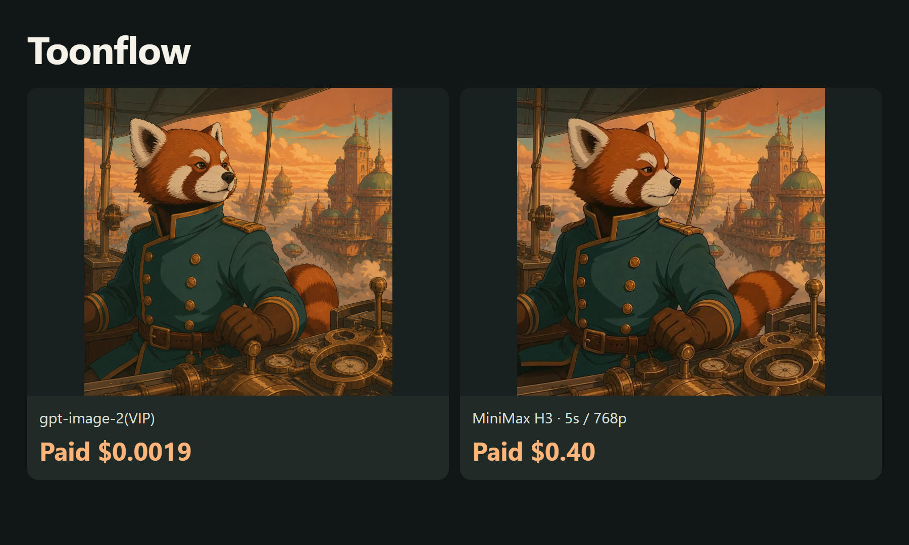

# Lower-cost Toonflow API asset examples

<!-- TOAPIS-MODEL-COST-UPDATE-20261016 -->
## Tested model types, presets and costs

Updated October 16, 2026. These are tested historical presets/prices; this addition does not relabel the original batch below.

| Model (API ID) | Type | Tested preset | Unit quote | Confirmed unit charge | Count |
|---|---|---|---:|---:|---:|
| gpt-image-2(VIP) (`gpt-image-2-vip`) | Image | low / 1K / n=1 | $0.0019/image | $0.0019 | 1 |
| gpt-image-2.5-flare | Image | high / 1K / n=1 | $0.0225/image | $0.0225 | 1 |
| Nano Banana 2.1 (`gemini-nano-banana-2.1`) | Image | 1K / n=1 | $0.015/image | $0.015 | 1 |
| MiniMax H3 (`MiniMax-H3`) | Video / I2V | I2V / 5s / 768p / 1:1 | $0.4/clip | $0.4 | 1 |

Confirmed original image/video example subtotal: **$0.4394**.

Independent API assets validated; upstream native registration, UI and complete workflow remain unvalidated.

gpt-image-2(VIP), **from $0.0019/image**; the tested low/1K preset here is **$0.0019/image**. Different models, qualities and resolutions do not imply equivalent results.

[Video additions, parameters, costs and reuse](video_extra/README.md)
<!-- TOAPIS-VIDEO-PREVIEWS-20261016 -->
### Seedance video demos and clip costs

[](https://raw.githubusercontent.com/ToAPIs-2025/lower-cost-toonflow-toapis/main/video_extra/clips/seedance-2.mp4)

**Seedance 2** · 480p · 4.04s · **$0.25497/clip** · about $0.063111/s

API-settled amounts; the new tasks await billing-sheet cross-check. USD/s is specific to these clips.

<!-- /TOAPIS-VIDEO-PREVIEWS-20261016 -->
<!-- /TOAPIS-MODEL-COST-UPDATE-20261016 -->

[English](README.md) · [中文](README_zh-CN.md)

Create storyboards and short dramas.

October 16, 2026: 3 real images and 1 real video. Confirmed charge for these completed assets: **$0.4394 (87.88 credits)**, reconciled by task ID against the owner-provided dashboard export.

[ToAPIs · model pricing and setup](https://go2v.toapis.com/tf16ge)

## Examples



[](https://raw.githubusercontent.com/ToAPIs-2025/lower-cost-toonflow-toapis/main/demo/first-frame-motion.mp4)

[Play/download the real 5-second clip](https://raw.githubusercontent.com/ToAPIs-2025/lower-cost-toonflow-toapis/main/demo/first-frame-motion.mp4) · [MP4](demo/first-frame-motion.mp4)

## Models and costs in this run

| Model | Preset | Catalog estimate / output | Settled charge |
|---|---|---:|---|
| gpt-image-2(VIP) | low / 1K | $0.0019 | $0.0019 |
| gpt-image-2.5-flare | high / 1K | $0.0225 | $0.0225 |
| Nano Banana 2.1 | 1K | $0.015 | $0.015 |
| MiniMax H3 | 5s / 768p / first-frame | $0.40 ($0.08/s) | $0.4 |

Catalog rates and confirmed charges match for these tested presets. Charges were reconciled against the owner-provided dashboard export at USD 0.005 per credit. Different models/presets do not imply equal quality. See evidence and examples for task records and originals.

## Run it

```bash
python -m pip install -r requirements.txt
python run_case.py --job jobs/gpt-image-2-vip.json
# Set TOAPIS_API_KEY privately in your local environment first.
python run_case.py --job jobs/gpt-image-2-vip.json --live
python run_case.py --job jobs/video.json --live
```

Dry-run by default. --live explicitly enables paid calls. Stable run_id values preserve task receipts; uncertain submissions are not automatically retried. Never commit .env, keys or private task state.

## Integrating with the original project

[Project-specific integration notes](integration/README.md) · [API contract](integration/toapis-contract.json)

[Toonflow upstream](https://github.com/HBAI-Ltd/Toonflow-app) · SHA `d2e94aca7b59659ff6b4ca15f03cf134ec7f0e1d`

These are original, independent ToAPIs asset/API examples, not an official upstream release or an accepted native provider. Full upstream UI, native registration and complete workflows still need maintainer acceptance. No upstream source is redistributed.
